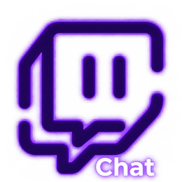

<div align="center">



# Twitch chat 7TV

**Лёгкий чат Twitch для OBS с 7TV-смайлами, своими рамками, шрифтами и визуальным конструктором.**

[](https://github.com/Koty9n/Twitch-chat-7TV/releases/latest)


[Скачать последнюю версию](https://github.com/Koty9n/Twitch-chat-7TV/releases/latest) · [Установка](#установка) · [Подключение к OBS](#подключение-к-obs)

</div>

---

## Что это

Локальная программа, которая читает чат Twitch и показывает его в OBS как обычный источник «Браузер». Работает на вашем компьютере, ничего никуда не отправляет.

- **7TV и Twitch-смайлы** с кешем на диске: каждый смайл скачивается один раз
- **Конструктор чата**: готовые рамки, градиенты, свечение, своя PNG-подложка, декор, который перетаскивается мышкой
- **Значки** стримера, модератора и главного модератора у ника, включаются и выключаются
- **Шрифты**: 14 готовых и свои файлы, настройка толщины
- **Эффекты для отдельных ников**: градиент, свечение, префикс
- **Анимации** появления и исчезновения
- **Защита от просадок FPS** в играх: режимы оптимизации, лимит сообщений, автозащита, режим игры
- **Тёмная и светлая тема** приложения, сворачивание в трей, автозапуск с Windows, проверка обновлений
- Док-панель для OBS с быстрыми настройками и пресетами

## Установка

1. Скачайте архив **`Twitch_chat_7TV.zip`** со страницы [Releases](https://github.com/Koty9n/Twitch-chat-7TV/releases/latest) и распакуйте его в любую папку.
2. Запустите **`install.bat`** двойным кликом. Он найдёт Python 3.9+ (если его нет, откроет страницу загрузки; при установке отметьте «Add python.exe to PATH»), поставит зависимости и создаст ярлык «Twitch chat 7TV» на рабочем столе.
3. Запускайте программу ярлыком. Откроется окно программы, чёрного окна консоли нет.
4. В окне введите канал и нажмите «Сохранить и подключить».

> Закрытие окна программу **не останавливает**, чат в OBS продолжает работать. Полностью закрыть: кнопка «Выход» в окне, пункт «Выход» в трее или `stop.bat`.

## Подключение к OBS

1. **Вывод чата на стрим**: добавьте источник **«Браузер»**, URL `http://127.0.0.1:8787/overlay`, размер под нужную область чата (например 600×900). Фон прозрачный, CSS вставлять не нужно.
2. **Док-панель** (по желанию): `Док-панели → Пользовательские док-панели браузера`, имя `Chat`, URL `http://127.0.0.1:8787/dock`.

Адреса также лежат в окне программы, кнопка «Ссылки для OBS» с копированием. Все изменения применяются в чате сразу, без перезапуска.

> Для лёгкости на стриме в свойствах источника «Браузер» поставьте частоту кадров 20–30 и включите «Отключать источник, когда он не виден».

---

## Подробная документация

Каждый раздел раскрывается по стрелочке.

<details>
<summary><b>Окно программы и док OBS</b></summary>

<br>

**Окно программы** (адрес `http://127.0.0.1:8787/app`) состоит из вкладок:

| Вкладка | Что внутри |
|---|---|
| Быстро | режим игры, масштаб, оптимизация, шрифт, пресеты |
| Вид | шрифт и толщина, значки у ника, отступы, масштаб |
| Анимации | появление, исчезновение, время жизни, лимиты |
| Ники | эффекты и значки для отдельных ников |
| Фильтры | скрытие команд, игнор-лист, запрещённые слова |
| Журнал | журнал работы программы |

Справа всегда большой пример чата. Галочка «Авто-примеры» сама присылает тестовые сообщения. Сверху кнопки «Ссылки для OBS», «Настройки» и «Выход».

**Док в OBS** компактный, только то, что нужно во время стрима:

- **Режим игры**: одной кнопкой отключает анимации, свечения и анимированные смайлы
- **Масштаб чата** (50–200%): весь чат целиком, область в OBS не меняется
- **Оптимизация** плашкой: Эконом, Баланс, Максимум
- **Шрифт**: 14 готовых и загруженные
- **Пресеты**: «Сохранить» запоминает текущий вид, кнопка с названием применяет, «✕» (нажать дважды) удаляет
- кнопки «Тест», «Очистить» и «Программа»

Пресеты запоминают внешний вид (конструктор, шрифт, масштаб, анимации, оптимизацию). Подключение и фильтры они не затрагивают. Лежат в `data/config.json` и сохраняются при обновлении.

</details>

<details>
<summary><b>Конструктор чата</b></summary>

<br>

Кнопка «Открыть конструктор чата» в окне программы или адрес `http://127.0.0.1:8787/editor`. Слева настройки, справа пример, всё сразу уходит в OBS.

- **Рамки**: 10 готовых оформлений (Космос, Неон, Золото, Стекло, Пиксель, Закат, Лёд, Сакура, Тёмная плашка, Только текст). Рамка задаёт заливку, контур, свечение, отступы и декор, потом всё можно править.
- **Подложка**: одноцветная или с градиентом, контур, свечение, тень, либо своя PNG.
- **Градиент**: накладывается поверх подложки, в том числе поверх PNG по форме картинки, угол и прозрачность настраиваются.
- **Текст**: отступы, выравнивание, ник отдельной строкой, ширина, **расстояние между сообщениями** (0–80 px), масштаб чата, масштаб текста и смайлов, шрифт и толщина, значки.
- **Декор**: свои PNG/WebP/GIF, символы и эмодзи, которые **перетаскиваются мышкой прямо в примере**. У каждого элемента размер, поворот, прозрачность, отражение, слой (перед текстом, под текстом, под подложкой) и анимация (парение, покачивание, пульсация, вращение, мигание). Декор привязывается к ближайшему углу или краю сообщения. Стрелки двигают элемент на 1 px, с Shift на 10.

Картинки декора лежат в `data\decor` и сохраняются при обновлении.

</details>

<details>
<summary><b>PNG-подложка</b></summary>

<br>

Загрузите PNG кнопкой «＋». Нарезка подбирается **автоматически** (кнопка «Авто-нарезка» повторяет её): ищется однородная середина, которую можно растягивать. Прозрачные поля, рамка и декор по краям остаются как есть, текст в них не попадает.

Режимы:

- **9-slice** (по умолчанию): углы и края не искажаются, тянется только середина
- **Рамка 1:1 без масштабирования**: рамка в натуральном размере, текст подгоняется ползунком «Масштаб текста и смайлов» (30–150%)
- **Растянуть целиком**: вся картинка тянется под размер сообщения
- **Заполнить без искажений**: сохраняет пропорции и обрезается по краям, включается сам, если у PNG нет однородной середины

Если после смены размера шрифта текст не умещается, нажмите «Авто-нарезка» заново или поправьте отступы и линии нарезки вручную (их можно тянуть мышкой по картинке).

</details>

<details>
<summary><b>Значки, шрифты и тема</b></summary>

<br>

**Значки у ника.** Стример, модератор и главный модератор берутся из Twitch автоматически и рисуются самой программой. Включаются во вкладке «Вид» и в конструкторе: все сразу или каждый отдельно. Для конкретного ника (вкладка «Ники») значок можно скрыть или всегда показывать нужный.

**Шрифты.** Готовые системные: Segoe UI, Arial, Arial Black, Verdana, Tahoma, Trebuchet MS, Calibri, Georgia, Times New Roman, Palatino Linotype, Courier New, Consolas, Impact, Comic Sans MS. Они берутся из Windows, на другом компьютере вид может отличаться. Свои шрифты: `.ttf`, `.otf`, `.woff`, `.woff2`, лежат в `data/fonts`.

**Толщина** текста и ника (100–900) настраивается в конструкторе и во вкладке «Вид». У некоторых шрифтов нет всех начертаний, тогда толщина меняется не везде.

**Тема приложения**: тёмная (по умолчанию), светлая или «как в системе». Переключатель находится в «Настройки → Оформление». Тема относится к окну программы, доку и конструктору, на сам чат в OBS не влияет.

</details>

<details>
<summary><b>Эффекты для ников</b></summary>

<br>

Вкладка «Ники»: введите логин на Twitch и нажмите «Добавить». Для каждого ника можно настроить:

- **Градиент** из 2–3 цветов (готовые: радуга, огонь, лёд, золото, неон, закат) и **переливание**
- **Свечение** со своим цветом и силой, **пульсацию**
- **Цвет ника** (без градиента) и **префикс** (эмодзи до 8 символов)
- применение эффектов **к тексту сообщения** и свечение вокруг всей подложки
- показ или скрытие **значков** этого ника

Кнопка ▶ в карточке показывает сообщение от этого ника в примере. Эффекты применяются к новым сообщениям.

</details>

<details>
<summary><b>Анимации</b></summary>

<br>

- **Появление**: выезд сбоку, снизу вверх, pop, bounce, плавное, blur, flip, проявление слева
- **Исчезновение**: затухание, уезжает, сжатие
- Время жизни сообщения, лимит сообщений и интервал

</details>

<details>
<summary><b>Настройки программы</b></summary>

<br>

Кнопка «Настройки» сверху в окне программы:

- **Twitch**: канал, ник и OAuth-токен
- **Производительность**: режим оптимизации, лимит новых сообщений в секунду, автозащита FPS, лимит кеша смайлов, диагностика нагрузки
- **Запуск**: автозапуск с Windows (стартует в фоне, без окна) и что делает закрытие окна: *свернуть в трей* (клик по значку открывает окно, правый клик даёт меню с режимом игры и выходом) или *закрыть программу полностью*
- **Обновления**: кнопка «Проверить обновления», при новой версии появляется «Установить» (скачает архив, обновит файлы без потери настроек и перезапустит программу)
- **Оформление**: тема приложения

Значок трея ставится вместе с библиотеками `pystray` и `Pillow`: после обновления запустите `install.bat`.

</details>

<details>
<summary><b>Токен (API-ключ)</b></summary>

<br>

Для чтения чата токен **не обязателен**, без него подключение анонимное. Если нужен авторизованный вход, укажите ник аккаунта и OAuth-токен со scope `chat:read`.

Токен хранится в `data/config.json` открытым текстом: не показывайте этот файл на стриме и не выкладывайте его. Сервер слушает только `127.0.0.1`, снаружи недоступен.

</details>

<details>
<summary><b>Производительность и защита от просадок FPS</b></summary>

<br>

Основная нагрузка идёт не от сервера (он почти ничего не потребляет), а от отрисовки чата в браузере OBS.

**Режимы оптимизации**

| Режим | Что делает |
|---|---|
| Эконом | смайлы статичные, нет бесконечных анимаций, blur заменён на плавное появление |
| Баланс (по умолчанию) | смайлы анимированы, бесконечных анимаций нет |
| Максимум | всё включено |

**Режим игры.** Кнопка в доке, в быстрых настройках и в меню трея. Отключает анимации, свечения, тени и анимированные смайлы. Настройки не стираются, при выключении вид возвращается.

**Защиты (Настройки → Производительность)**

- **Лимит новых сообщений в секунду** (по умолчанию 5): рейд или спам не создаёт пик нагрузки, лишнее отбрасывается
- **Автозащита FPS** (включена по умолчанию): пока чат анимируется, следит за рывками кадров и при подтормаживании упрощает эффекты ступенями (Максимум, Баланс, Эконом, без анимаций). В покое ничего не измеряется. Сбрасывается при любом изменении стиля или перезагрузке источника.
- **Окно программы** открывается в отдельном процессе браузера с пониженным приоритетом, а пример в нём останавливается, когда окно не в фокусе. Во время игры окно лучше закрыть.
- Сервер работает с пониженным приоритетом.

**Что сделано внутри**

- сообщения выводятся не чаще ~30 в секунду, в DOM держится не больше «Макс. сообщений»
- GPU-слой держится только пока идёт анимация появления
- смайлы скачиваются один раз и берутся с диска, предзагрузка идёт в отдельной очереди с низким приоритетом
- файлы отдаются с ETag (304 без чтения с диска)
- кеш смайлов сам чистится при старте, если вырос больше лимита (по умолчанию 400 МБ), удаляются самые старые
- нет консоли и записи на каждый запрос

**Диагностика** (Настройки → «Диагностика нагрузки») показывает нагрузку сервера и оверлея: сообщений и смайлов на экране, время кадра, долгие задачи. Сам чат считается в процессе OBS (`obs-browser-page`), его ищите в диспетчере задач.

**В OBS**: частота кадров источника «Браузер» 20–30, включить «Отключать источник, когда он не виден», не делать источник больше нужной области.

</details>

<details>
<summary><b>Обновление</b></summary>

<br>

**Из программы.** Укажите источник обновлений в «Настройки → Обновления»: GitHub-репозиторий в виде `Koty9n/Twitch-chat-7TV` (берётся последний Release, тег вида `v1.5.0` и приложенный zip). Либо https-ссылка на `version.json`:

```json
{"version": "1.5.0", "url": "https://.../Twitch_chat_7TV.zip", "notes": "что нового"}
```

Автоустановка работает для обычной установки в Windows. Для `.exe` показывается ссылка на скачивание.

**Через `update.bat`.** Запустите его, выберите zip с новой версией (или перетащите zip на `update.bat`). Скрипт закроет приложение (спросит), сохранит копию текущих файлов в `_backup\<дата>`, заменит файлы программы и при необходимости обновит зависимости. Папка `data` (настройки, токен, подложки, шрифты, кеш) и окружение `.venv` не затрагиваются.

</details>

<details>
<summary><b>Запуск без установки, один .exe, ручной запуск</b></summary>

<br>

- Без окна: `start.bat --no-window`
- С консолью для поиска ошибок: `start_debug.bat` (то же самое лежит в `data\app.log`)
- Остановить: `stop.bat`
- **Один .exe**: после установки запустите `build_exe.bat`, готовый `dist\TwitchChat7TV.exe` можно положить куда угодно, папка `data/` создастся рядом
- Без `.bat`: `pip install -r requirements.txt`, затем `python server.py`

Всё хранится в папке `data/`: настройки, подложки, шрифты, кеш смайлов.

</details>

<details>
<summary><b>Если что-то не работает</b></summary>

<br>

- **Смайлов 7TV нет**: нажмите «Обновить смайлы». Список подгружается после первого сообщения в чате. Используется API `7tv.io/v3`, если 7TV его отключит, поменяйте константы `SEVENTV_*` в начале `server.py`.
- **Ошибка токена**: проверьте, что ник совпадает с владельцем токена.
- **Порт занят**: измените `port` в `data/config.json`.
- **Программа не стартует**: запустите `start_debug.bat` и посмотрите `data\app.log`. Ошибки при запуске показываются отдельным окном Windows.
- **Окна нет, а программу нужно закрыть**: запустите `stop.bat`.
- **Нет значка в трее**: запустите `install.bat`, он доустановит `pystray` и `Pillow`.

</details>

<details>
<summary><b>Структура папки</b></summary>

<br>

| Файл | Назначение |
|---|---|
| `server.py` | сервер: чат Twitch, кеш смайлов, API, трей |
| `overlay.html` | страница чата для OBS |
| `app.html`, `dock.html`, `editor.html` | окно программы, док, конструктор |
| `bubble.js`, `bubble.css` | общий рендер сообщений для чата и конструктора |
| `quick.js`, `theme.js`, `theme.css` | быстрые настройки и темы |
| `install.bat`, `start.bat`, `start_debug.bat`, `stop.bat`, `update.bat`, `build_exe.bat` | установка, запуск, обновление, сборка |
| `data/` | настройки, кеш, шрифты, подложки (создаётся при запуске, в репозиторий не входит) |

</details>

---

<div align="center">

Программа не связана с Twitch, 7TV и OBS Project. Все названия принадлежат их владельцам.

</div>
